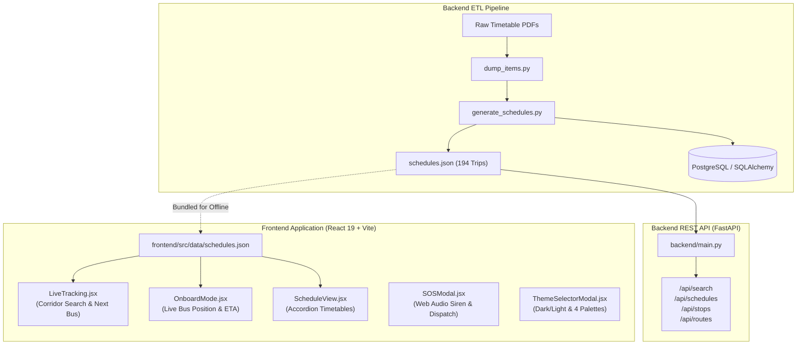

# 🚌 MyBRTS (Tatpar BRT Raipur & Nava Raipur Bus Tracker)

An intelligent, mobile-first Bus Rapid Transit System (BRTS) live tracker and journey planner for **Raipur & Nava Raipur Atal Nagar**.

Built with a dual-mode architecture:
1. **Frontend Client-First PWA**: High-performance, offline-capable React 19 single-page application with zero-latency client-side timetable calculations, time-based bus position interpolation, 100% offline emergency audio sirens, and multilingual localization.
2. **Backend REST API**: Python FastAPI service with data ingestion pipelines, PDF ETL extractors, and SQLAlchemy models for relational database management.

---

## 📑 Table of Contents
1. [Architecture Overview](#-architecture-overview)
2. [Frontend Functions & File Registry](#-frontend-functions--file-registry)
   - [Root & Entry Files](#1-root--entry-files)
   - [Pages / Views](#2-pages--views)
   - [UI Components](#3-ui-components)
   - [Utilities & i18n](#4-utilities--internationalization-i18n)
3. [Backend Functions & File Registry](#-backend-functions--file-registry)
   - [FastAPI REST Service](#1-fastapi-rest-service)
   - [Database ORM Models](#2-database-orm-models)
   - [ETL, Ingestion & Analysis Pipeline](#3-etl-ingestion--data-analysis-pipeline)
4. [Data Flow Lifecycle](#-data-flow-lifecycle)
5. [Getting Started & Local Setup](#-getting-started--local-setup)

---

## 🏗️ Architecture Overview



---

## 🎨 Frontend Functions & File Registry

All frontend source files reside under the [`frontend/src/`](file:///Users/pragyan_pandey/myBRTS/frontend/src/) directory.

### 1. Root & Entry Files

#### [`frontend/src/main.jsx`](file:///Users/pragyan_pandey/myBRTS/frontend/src/main.jsx)
The bootstrapping entry point for the React 19 application.
* **Entry Execution**:
  * Locates the root DOM container element (`#root`).
  * Creates the React concurrent root using `createRoot(document.getElementById('root'))`.
  * Mounts `<App />` enclosed in `React.StrictMode`.

#### [`frontend/src/App.jsx`](file:///Users/pragyan_pandey/myBRTS/frontend/src/App.jsx)
The top-level state manager and layout orchestrator.
* **Functions**:
  * `App()`: The primary application component.
    * **State Managed**:
      * `lang`: Selected UI language (`'en'`, `'hi'`, `'cg'`).
      * `view`: Active primary screen (`'linear'` for live search, `'onboard'` for on-bus mode, `'schedule'` for timetables).
      * `sheet`: Active bottom sheet modal (`'fare'` or `null`).
      * `mode`: Color mode (`'dark'` or `'light'`), synchronized with `localStorage`.
      * `colorTheme`: Accent palette (`'neon'`, `'cyberpunk'`, `'emerald'`, `'sunset'`), synchronized with `localStorage`.
      * `isThemeOpen`: Boolean toggle for the theme customizer modal.
      * `isSOSOpen`: Boolean toggle for the floating emergency SOS modal.
    * **Side Effects (`useEffect`)**:
      * Updates `document.documentElement` attributes (`data-theme`, `data-color`) and dynamically writes CSS custom properties (`--bg-primary`, `--accent-cyan`, `--accent-color`) whenever theme or mode toggles.
    * **Renders**:
      * Sticky `<Header />` with brand, language switcher, theme trigger, and SOS button.
      * Dynamic view routing (`<LiveTracking />`, `<OnboardMode />`, or `<ScheduleView />`).
      * Persistent mobile `<BottomNav />`.
      * Modal overlays (`<BottomSheet />`, `<ThemeSelectorModal />`, `<SOSModal />`).

---

### 2. Pages / Views

#### [`frontend/src/pages/LiveTracking.jsx`](file:///Users/pragyan_pandey/myBRTS/frontend/src/pages/LiveTracking.jsx)
Main corridor search and next departure finder between any two chosen stations.
* **Functions**:
  * `LiveTracking({ lang })`: Main page component for corridor transit lookups.
  * `timeToMins(tStr)`:
    * **Parameters**: `tStr` (String, e.g., `"07:15 AM"`).
    * **Returns**: Integer (minutes elapsed since midnight, e.g., `435`).
    * **Purpose**: Normalizes 12-hour AM/PM timestamps for mathematical comparisons, sorting, and duration calculations.
  * `swap()`:
    * **Parameters**: None.
    * **Purpose**: Swaps `from` and `to` stations in state, flipping the direction of travel instantly.
  * `showToast(msg)`:
    * **Parameters**: `msg` (String).
    * **Purpose**: Sets transient message state with an automatic 3-second timeout for dismissible animated alerts (e.g. setting/disarming destination alarms).
  * `setExpandedTripId(prev => ...)`:
    * **Purpose**: Accordion expansion toggle callback ensuring only the clicked scheduled trip expands to show intermediate stop times, keeping all other cards collapsed.
  * `matchingTrips (useMemo)`:
    * **Purpose**: Scans `schedules.json` to filter trips matching the selected `day` (weekday/weekend), checks if `from` precedes `to` in the stop sequence, extracts slice of intermediate stops, and sorts results by nearest departure time.

#### [`frontend/src/pages/OnboardMode.jsx`](file:///Users/pragyan_pandey/myBRTS/frontend/src/pages/OnboardMode.jsx)
Dedicated live tracking mode for passengers currently traveling on a bus.
* **Functions**:
  * `OnboardMode({ lang })`: Primary component for real-time onboard journey tracking.
  * `timeToMins(tStr)`:
    * **Parameters**: `tStr` (String, e.g., `"08:20 AM"`).
    * **Returns**: Total minutes from midnight.
  * `minsToTimeStr(totalMins)`:
    * **Parameters**: `totalMins` (Integer).
    * **Returns**: Formatted 12-hour timestamp string (e.g., `510` -> `"08:30 AM"`).
  * `showToast(msg)`:
    * **Parameters**: `msg` (String).
    * **Purpose**: Shows feedback toast when manual traffic delay adjustments are applied.
  * `handleSetDeparture(presetMinutesAgo)`:
    * **Parameters**: `presetMinutesAgo` (Integer, e.g., `0`, `10`, `20`, `30`, `45`).
    * **Purpose**: Calibrates the bus departure timestamp relative to the current clock time.
  * `handleAdjustOffset(deltaMins)`:
    * **Parameters**: `deltaMins` (Integer, e.g., `+5` or `-5`).
    * **Purpose**: Increments/decrements `manualOffset` to recalibrate stop calculations according to real-world traffic signals or delays.
  * `timelineData (useMemo)`:
    * **Purpose**: Core mathematical interpolation engine. Calculates total elapsed minutes since departure, matches against stop time offsets, and determines:
      * `currentStop`: The last passed or currently boarded station.
      * `nextStop`: The immediately approaching upcoming station.
      * `minsToNext`: Estimated minutes remaining until next stop arrival.
      * `journeyProgress`: Overall journey completion percentage (`0%` to `100%`).
      * `passedStops`: Array of stations already traversed with timestamps.

#### [`frontend/src/pages/ScheduleView.jsx`](file:///Users/pragyan_pandey/myBRTS/frontend/src/pages/ScheduleView.jsx)
Timetable explorer for inspecting all 194 BRTS trips.
* **Functions**:
  * `ScheduleView({ lang })`: Main timetable viewer component.
  * `toggleTrip(id)`:
    * **Parameters**: `id` (String, unique trip ID, e.g., `"we-up-001"`).
    * **Purpose**: Toggles accordion view for a specific trip, allowing intermediate stops inspection while closing any previously open card.
  * `filteredTrips (useMemo)`:
    * **Purpose**: Filters the schedule dataset by service type (`weekday` / `weekend`), travel direction (`Up Route` / `Down Route`), and specific route numbers (`ALL`, `101`, `201`, etc.).
  * `availableRoutes (useMemo)`:
    * **Purpose**: Aggregates a distinct, sorted list of all active route numbers matching the selected day and corridor direction.

#### [`frontend/src/pages/Schedule.jsx`](file:///Users/pragyan_pandey/myBRTS/frontend/src/pages/Schedule.jsx)
* **Function**: `Schedule()`
* **Purpose**: Standalone departure schedule component providing upcoming bus cards and estimated arrival timings.

#### [`frontend/src/pages/Dashboard.jsx`](file:///Users/pragyan_pandey/myBRTS/frontend/src/pages/Dashboard.jsx)
* **Function**: `Dashboard()`
* **Purpose**: High-level transit overview dashboard displaying nearest stop shortcuts, quick fare chart triggers, and active route preview cards.

---

### 3. UI Components

#### [`frontend/src/components/Header.jsx`](file:///Users/pragyan_pandey/myBRTS/frontend/src/components/Header.jsx)
Top navigation bar.
* **Functions**:
  * `Header({ lang, setLang, colorTheme, mode, onOpenTheme, onOpenSOS })`:
    * Renders the **Tatpar BRTS** emblem and active network beacon.
    * Language switcher dropdown toggle (English, Hindi, Chhattisgarhi).
    * Quick-launch buttons for Theme Customization Modal and Emergency SOS Modal.

#### [`frontend/src/components/BottomNav.jsx`](file:///Users/pragyan_pandey/myBRTS/frontend/src/components/BottomNav.jsx)
Mobile persistent bottom navigation bar.
* **Functions**:
  * `BottomNav({ view, setView, sheet, setSheet, lang })`:
    * 4 primary navigation triggers:
      1. **Live**: Linear corridor station-to-station planner.
      2. **On Bus**: Real-time onboard journey tracking with pulsating beacon.
      3. **Schedule**: Complete timetable directory.
      4. **Fare**: Triggers the fare matrix bottom sheet.

#### [`frontend/src/components/BottomSheet.jsx`](file:///Users/pragyan_pandey/myBRTS/frontend/src/components/BottomSheet.jsx)
Modal bottom slide-up overlay for fare rules.
* **Functions**:
  * `BottomSheet({ sheet, setSheet, lang })`: Renders the official Raipur BRTS zone-based fare slab matrix (₹10 inter-sector to ₹30 full route).
  * `handleClose()`: Dismisses the sheet and resets parent sheet state to `null`.

#### [`frontend/src/components/SOSModal.jsx`](file:///Users/pragyan_pandey/myBRTS/frontend/src/components/SOSModal.jsx)
Emergency assistance and audio siren system.
* **Functions**:
  * `SOSModal({ isOpen, onClose, lang, currentStop, routeNumber })`: Component modal for emergency actions.
  * `startSiren()`:
    * **Purpose**: Instantiates a browser `AudioContext`, creates an `OscillatorNode` with a `BiquadFilterNode` and `GainNode`, and modulates frequency between **960 Hz and 770 Hz** at 2 Hz intervals.
    * **Key Feature**: Functions **100% offline** without any external audio asset files or internet access.
  * `stopSiren()`:
    * **Purpose**: Stops the active audio oscillator and safely closes the `AudioContext`.
  * `formatWhatsAppMessage()`:
    * **Purpose**: Assembles a pre-filled emergency distress message containing active route, estimated stop coordinates, and timestamp into a `https://wa.me/` URI for rapid contact sharing.

#### [`frontend/src/components/StationPickerModal.jsx`](file:///Users/pragyan_pandey/myBRTS/frontend/src/components/StationPickerModal.jsx)
Full-screen searchable station selector.
* **Functions**:
  * `StationPickerModal({ isOpen, onClose, onSelect, currentStation, title, lang })`: Searchable modal for choosing bus stops.
  * `handleKeyDown(e)`: Closes the modal when the `Escape` key is pressed.
  * `filteredStations (useMemo)`: Filters stations matching the user search term across English, Hindi, and Chhattisgarhi station names, grouped by zones (**Raipur City**, **Nava Raipur Sectors**, **Institutional & Landmarks**).

#### [`frontend/src/components/StationSelect.jsx`](file:///Users/pragyan_pandey/myBRTS/frontend/src/components/StationSelect.jsx)
Inline station dropdown selector.
* **Functions**:
  * `StationSelect({ label, value, onChange, stations, disabledStation, lang })`: Alternative inline dropdown for picking origin and destination.
  * `handleClickOutside(e)`: Closes dropdown list when clicking anywhere outside the container.
  * `handleSelect(station)`: Sets selected station, triggers `onChange`, and closes dropdown.

#### [`frontend/src/components/ThemeSelectorModal.jsx`](file:///Users/pragyan_pandey/myBRTS/frontend/src/components/ThemeSelectorModal.jsx)
Appearance and palette manager.
* **Functions**:
  * `ThemeSelectorModal({ isOpen, onClose, mode, setMode, colorTheme, setColorTheme, lang })`:
    * Mode Toggle: Switches between **Dark Mode** and **Light Mode**.
    * Palette Selector: Switches between 4 neon aesthetic themes:
      * **Neon Green** (Atal Green)
      * **Cyberpunk Cyan** (Electric Cyan)
      * **Sunset Orange** (Raipur Sunset)
      * **Emerald** (Chhatisgarh Nature)

---

### 4. Utilities & Internationalization (i18n)

#### [`frontend/src/utils/translations.js`](file:///Users/pragyan_pandey/myBRTS/frontend/src/utils/translations.js)
Localization repository and translation helpers.
* **Data**:
  * `translations`: Dictionary containing translation mappings for UI keys across **English (`en`)**, **Hindi (`hi`)**, and **Chhattisgarhi (`cg`)**.
  * `stationTranslations`: Trilingual dictionary mapping every BRTS station name into Hindi and Chhattisgarhi.
* **Functions**:
  * `t(key, lang)`:
    * **Parameters**: `key` (String), `lang` (String).
    * **Returns**: Localized string with fallback to English if key is missing.
  * `getStationDisplayName(stationName, lang)`:
    * **Parameters**: `stationName` (String), `lang` (String).
    * **Returns**: Localized stop name in Hindi / Chhattisgarhi, falling back to original English name.

---

## ⚙️ Backend Functions & File Registry

All backend source files reside under the [`backend/`](file:///Users/pragyan_pandey/myBRTS/backend/) directory.

### 1. FastAPI REST Service

#### [`backend/main.py`](file:///Users/pragyan_pandey/myBRTS/backend/main.py)
The primary asynchronous REST API application built with FastAPI and Uvicorn.
* **Functions & Endpoints**:
  * `parse_time_mins(t_str: str) -> int`:
    * **Parameters**: `t_str` (String timestamp, e.g., `"07:30 AM"`).
    * **Returns**: Integer minutes from midnight.
    * **Purpose**: Internal helper function for timestamp parsing and sorting.
  * `read_root()` (`GET /`):
    * **Returns**: Health check JSON with API status, active message, and total trips count.
  * `get_schedules(day, route, direction)` (`GET /api/schedules`):
    * **Query Parameters**:
      * `day` (Optional[str]): Filter by `'weekday'` or `'weekend'`.
      * `route` (Optional[str]): Filter by route number (e.g., `'101'`).
      * `direction` (Optional[str]): Filter by direction string.
    * **Returns**: JSON object with matching trip count and trip records with intermediate stops.
  * `get_stops()` (`GET /api/stops`):
    * **Returns**: Sorted array of all unique station names present in the schedule dataset.
  * `get_routes()` (`GET /api/routes`):
    * **Returns**: Aggregated route summaries including route numbers, unique directions, service days, and trip counts.
  * `search_trips(origin, destination, day)` (`GET /api/search`):
    * **Query Parameters**:
      * `origin` (str, required): Boarding stop name.
      * `destination` (str, required): Drop-off stop name.
      * `day` (str, default `'weekday'`): Service type.
    * **Returns**: List of matching scheduled runs where `origin` precedes `destination`, complete with departure time, arrival time, travel duration in minutes, and intermediate stop counts.

---

### 2. Database ORM Models

#### [`backend/models.py`](file:///Users/pragyan_pandey/myBRTS/backend/models.py)
Defines relational database schemas using SQLAlchemy.
* **Classes**:
  * `BusSchedule(Base)`:
    * **Table Name**: `'bus_schedules'`
    * **Columns**:
      * `id`: Integer primary key, indexed.
      * `route_number`: String, indexed (e.g., `"101"`, `"201"`).
      * `departure_time`: Time field for route start.
      * `arrival_time`: Time field for route termination.
      * `origin`: String representing departure station.
      * `destination`: String representing destination station.

---

### 3. ETL, Ingestion & Data Analysis Pipeline

#### [`backend/generate_schedules.py`](file:///Users/pragyan_pandey/myBRTS/backend/generate_schedules.py)
The master ETL (Extract, Transform, Load) script that converts parsed PDF coordinates into the production `schedules.json` dataset.
* **Functions**:
  * `get_times(text)`:
    * **Parameters**: `text` (String).
    * **Returns**: List of normalized 12-hour timestamps (e.g., `["07:15 AM", "07:30 AM"]`).
    * **Purpose**: Cleans OCR space irregularities (`"07 : 15AM"` -> `"07:15 AM"`).
  * `calc_duration(t1, t2)`:
    * **Parameters**: `t1` (String start time), `t2` (String end time).
    * **Returns**: Travel duration in minutes, handling midnight boundary rollovers.
  * `add_feeder_trips(day_type, start_time_str, end_time_str, interval_mins, orig, dest, stops_template)`:
    * **Parameters**: Service day, start hour, end hour, frequency interval, origin, destination, and intermediate station template.
    * **Purpose**: Generates recurring feeder route trips (e.g., Route F-01 Nawagaon <-> North Block) at fixed intervals according to official BRTS Annexure rules.
  * **Main Execution**:
    * Groups visual PDF bounding boxes into coherent rows by Y-coordinates.
    * Associates stop sequences with parsed timestamps.
    * Outputs synchronized `backend/schedules.json` and `frontend/src/data/schedules.json`.

#### [`backend/dump_items.py`](file:///Users/pragyan_pandey/myBRTS/backend/dump_items.py)
Low-level coordinate extractor using `pypdf`.
* **Functions**:
  * `visitor_body(text, cm, tm, font_dict, font_size)`: Callback function passed to `pypdf` page text extractor. Captures text content along with exact page coordinates `(x, y)` to preserve table columns during parsing.
  * **Output**: Writes `pdf_items.json`.

#### [`backend/analyze_rows.py`](file:///Users/pragyan_pandey/myBRTS/backend/analyze_rows.py)
Row structure analyzer for debugging table alignment.
* **Functions**:
  * `parse_time_list(text)`: Extracts sequential timestamps from text rows to identify stop-to-time mapping anomalies.

#### [`backend/parse_all.py`](file:///Users/pragyan_pandey/myBRTS/backend/parse_all.py)
Regex-based text parser for raw PDF text dumps.
* **Functions**:
  * `clean_time(t)`: Standardizes malformed time tokens.
  * `extract_times(text)`: Extracts all time patterns from unstructured text blocks.

#### [`backend/parse_pdf.py`](file:///Users/pragyan_pandey/myBRTS/backend/parse_pdf.py)
Direct PDF extractor script utilizing `pdfplumber` for tabular inspection.

#### [`backend/inspect_weekends.py`](file:///Users/pragyan_pandey/myBRTS/backend/inspect_weekends.py)
Data verification script checking coordinate thresholds between weekday and weekend timetable sections.

---

## 🔄 Data Flow Lifecycle

1. **Extraction (Offline)**: Official BRTS timetable PDF is parsed by [`backend/dump_items.py`](file:///Users/pragyan_pandey/myBRTS/backend/dump_items.py) and [`backend/generate_schedules.py`](file:///Users/pragyan_pandey/myBRTS/backend/generate_schedules.py) to generate 194 normalized trip schedules.
2. **Bundling / API Serving**:
   - For **Vercel Edge Deployment**: Output JSON is bundled into [`frontend/src/data/schedules.json`](file:///Users/pragyan_pandey/myBRTS/frontend/src/data/schedules.json) for zero-latency client evaluation.
   - For **Full-Stack Deployment**: Output JSON is served via FastAPI ([`backend/main.py`](file:///Users/pragyan_pandey/myBRTS/backend/main.py)) on endpoints `/api/schedules` and `/api/search`.
3. **Client State Processing**:
   - [`LiveTracking.jsx`](file:///Users/pragyan_pandey/myBRTS/frontend/src/pages/LiveTracking.jsx) filters matching trips between user-selected stations in real-time.
   - [`OnboardMode.jsx`](file:///Users/pragyan_pandey/myBRTS/frontend/src/pages/OnboardMode.jsx) interpolates elapsed minutes against scheduled stop deltas to advance the active bus marker along the route.
4. **Safety & Alerts**:
   - [`SOSModal.jsx`](file:///Users/pragyan_pandey/myBRTS/frontend/src/components/SOSModal.jsx) synthesizes local audio sirens via the Web Audio API and formats live location telemetry for emergency dispatch.

---

## 🚀 Getting Started & Local Setup

### Prerequisites
- **Node.js** (v18 or higher) & **npm**
- **Python** (v3.10 or higher)

### 1. Frontend Setup
```bash
# Navigate to frontend
cd frontend

# Install dependencies
npm install

# Start Vite development server (Port 3000)
npm run dev -- --port 3000

# Build for production
npm run build
```

### 2. Backend Setup (Optional)
```bash
# Navigate to backend
cd backend

# Create virtual environment
python3 -m venv venv
source venv/bin/activate

# Install dependencies
pip install -r requirements.txt

# Start FastAPI server with Uvicorn
uvicorn main:app --reload --port 8000
```
API Documentation will be accessible at `http://localhost:8000/docs`.

---

## 📄 License
Open-source under the MIT License. Developed for the commuters of Raipur & Nava Raipur Atal Nagar.
